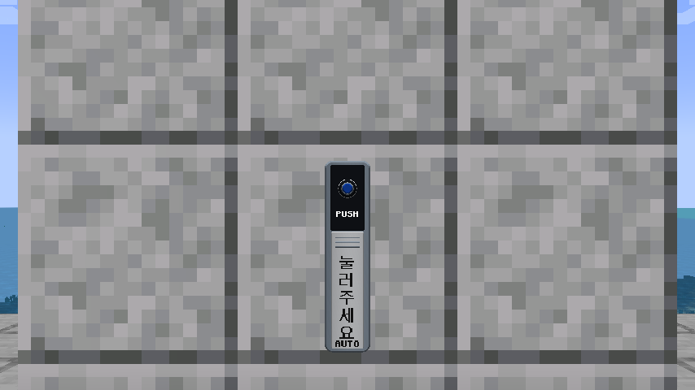
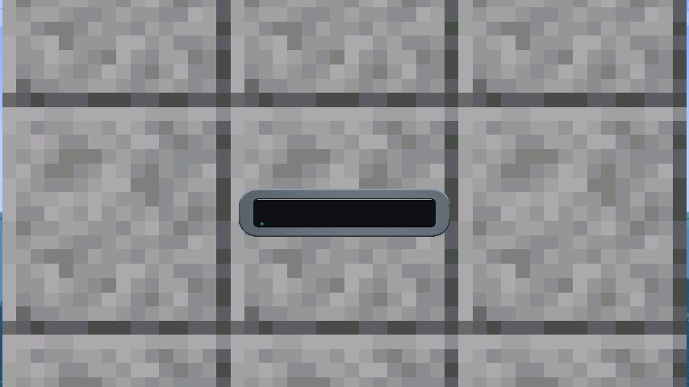
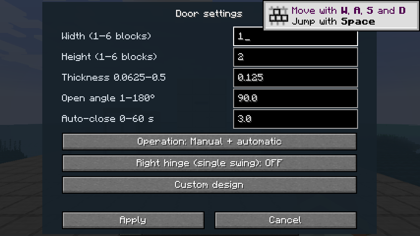
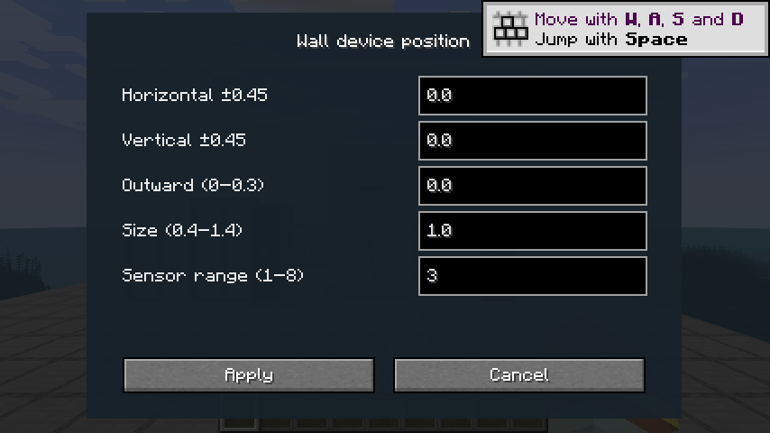
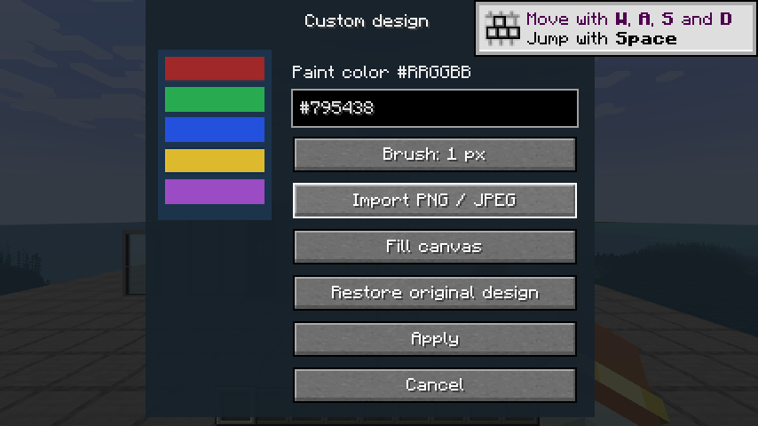
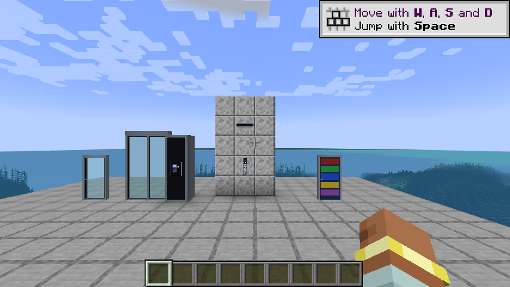
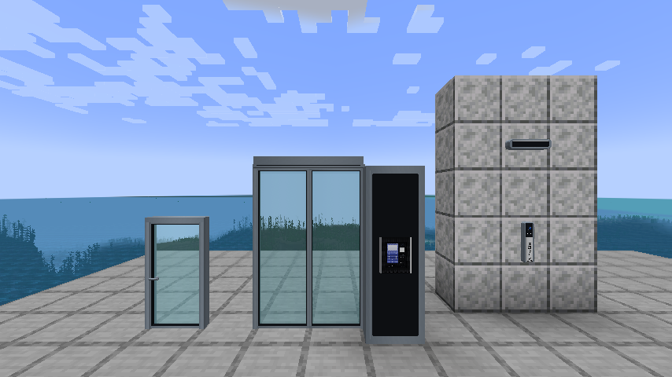
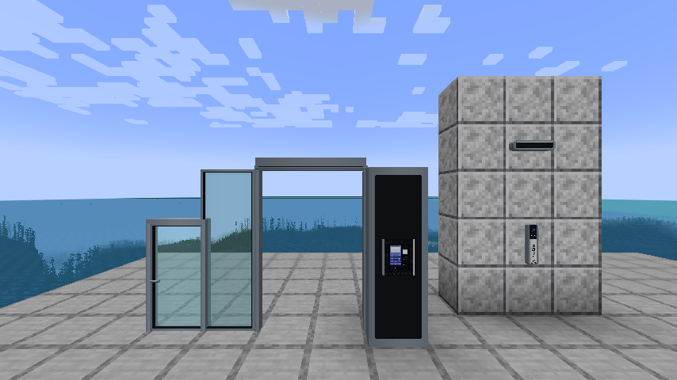

# 실제 게임 화면 — 0.3.0

Minecraft 1.20.1 / Forge 47.4.0 클라이언트에서 직접 렌더링하고 캡처했습니다.
이미지를 합성하거나 첨부 제품 사진을 게임 화면에 붙인 결과가 아닙니다.

## 벽 부착 버튼

둥근 몸체, 파란 버튼과 링, 홈, PUSH·세로 한글·AUTO 문구입니다.

## 벽 부착 동작 센서

둥근 금속 몸체, 긴 검은 감지창과 표시등입니다.

## 문 설정과 기기 위치

## 사진·그리기 편집

테스트용 색상 이미지의 PNG/JPEG 가져오기, 브러시 입력, 서버 전송과 정확한 픽셀 왕복을 검증했습니다.

## 로비폰 설치형 자동문

원본 홈넷 로비폰이 고정 기둥에 붙은 상태와 열림 버튼으로 열린 상태입니다.

